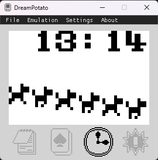
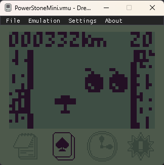
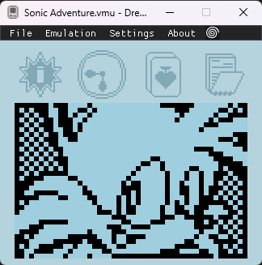
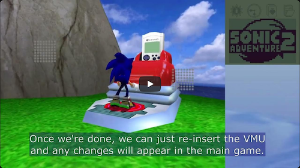

# DreamPotato

DreamPotato is a Dreamcast VMU emulator.

> [!WARNING]
> When opening a `.vmu` or `.bin` file, the emulator will modify the file on disk while running in order to persist changes, such as save file changes on the memory card, saving your progress in minigames, or when using the Load State command.
> Consider making copies of VMU files before using them to avoid any chance of corrupting your saves.
> `.vms` files opened in the emulator will not be modified.

[Download Latest Release](https://github.com/RikkiGibson/DreamPotato/releases/latest)

See [compatibility.md](compatibility.md) for the current compatibility status of various games.

    
    
    

## Hollycast Integration

DreamPotato can connect to [Hollycast](https://github.com/OrangeFox86/Hollycast) to support an experience similar to using a real Dreamcast and VMU together.

Instructions:
1) Download the Hollycast release, which has compatible versions of Hollycast + DreamPotato to use together. Make sure the two apps are kept in the same folder.
2) Open the Hollycast controller settings. Pick DreamPotato as the expansion device type for the desired ports/slots. (i.e. use "DreamPotato" instead of "Sega VMU".)
    - Settings **Use External VMU Memory** and **DreamPotato Integrated Mode** are enabled by default. They should be left enabled for best results.
3) Hit "Done". DreamPotato should launch automatically. You should see the swirl icon in the DreamPotato menu bar indicating things are connected.
4) If you get disconnected, you can close DreamPotato if needed, and open/close the settings page to relaunch it.

Additional notes/caveats:
1) DreamPotato does not play sound while docked to a controller. You should leave the Hollycast VMU sound setting enabled if you want that. (DreamPotato *does* play sound in standalone mode.)
2) You can use DreamPotatoes with as many slots/ports as you want. A separate window will open for each port.

## Usage

Download the latest bits from the [Releases](https://github.com/RikkiGibson/DreamPotato/releases) section.

### Default Key Mappings
- W - Up
- A - Left
- S - Down
- D - Right
- K - A
- L - B
- I - Mode
- J - Sleep
- Insert - Dock/Eject VMU to Dreamcast controller
    - You can also hold the Sleep button for 1 second to toggle docking/ejecting the VMU.
- F5 - Save State
- F8 - Load State
- F10 - Pause/Resume
- Tab (hold) - Fast Forward

### Open Folder

DreamPotato has "Open Folder" and "Save As Folder" commands inspired by the "GCI Folder" support in Dolphin. When a folder is opened, DreamPotato loads all the `.vmi`/`.vms` files found in it. When the VMU's file contents change during gameplay, DreamPotato will automatically update the corresponding files in the folder.

Notes:
- "Save As Folder" is a convenient way to extract individual `.vmi`/`.vms` saves from your `.vmu`/`.bin` memory card file.
- You can rename the `.vmi`/`.vms` file pairs whatever you want, as long as the filenames match. DreamPotato will continue to pick them up and the on-VMU filenames will be preserved.
    - For example, if I have `S.ARCADIA001.vms` and `S.ARCADIA001.vmi` files for Skies of Arcadia, I could rename them to `My file.vms` and `My file.vmi`, and the game will continue to recognize them as an `S.ARCADIA001` file on the VMU.
- You can put any non-`.vmi`/`.vms` items in the folder you want and DreamPotato will ignore them.
- DreamPotato doesn't watch the opened folder, so if you manually make changes in it, you need to reopen the folder in DreamPotato for the changes to get picked up.
- It's recommended to "Save As Folder" to a folder which doesn't already contain any `.vmi`/`.vms` files in it. If you do, files might get overwritten, or other conflicts could occur in the folder, which you'll have to clean up manually.
- `fs_root.bin` contains file system metadata as well as the VMU's color and icon (for display in the Dreamcast BIOS). If you delete it, it will be re-created with default settings.

### Configuration

General configuration options include:
- `AutoInitializeDate`: bool, default true. If true, skips the startup beep and date setup, and uses your computer's clock to initialize the VMU's clock. Specify false if you want to use the date setup sequence as you would when installing batteries with real hardware.
- `AutoDockEject`: bool, default true. If true, automatically docks the VMU when Flycast is connected, and ejects it when Flycast is disconnected.
- `AnyButtonWakesFromSleep`: bool, default true. If true, any button will wake the VMU from sleep. If false, only the sleep button will do that.

Key and button mappings can be changed in Settings -> Keyboard Config / Gamepad Config.

## Building

- Install a .NET SDK 9 matching the version in `global.json`.
    - Easiest: install [`dotnetup`](https://github.com/dotnet/sdk/tree/release/dnup/documentation/general/dotnetup), then run `dotnetup` in this folder.
    - Alternatively: [download](https://dotnet.microsoft.com/en-us/download/dotnet) and run .NET SDK from Microsoft's website.
- Copy your `american_v1.05.bin` VMU ROM into `src/DreamPotato.Core/Data/`.
- Build everything: `dotnet build`.
- Run the emulator: `dotnet run --project src/DreamPotato.MonoGame.Desktop`.
- Run tests: `dotnet test`

## Project Overview

Under `src/`:
- `DreamPotato.Core` is where the emulator implementation resides.
- `DreamPotato.Tests` includes unit tests for the emulator implementation.
- `DreamPotato.MonoGame` is most of the front-end, including UI and config file handling.
- `DreamPotato.MonoGame.Desktop` is the desktop (Windows/macOS/Linux) application.
- `dreampotato-vscode` is the VS Code extension--in *very* barebones/"alpha" state.
    - Currently, it contains only a TextMate grammar for LC86k assembly.

## Why write a new emulator?

The biggest reason was: I was interested in timing-based luck manipulation in Pinta's Quest, which requires emulating the game at a very similar speed to real VMU hardware. I found that existing emulators did not run the game at a similar enough speed to real hardware to allow the same timings to work. I thought that writing a new emulator from scratch would be a good way to learn the hardware well enough to get to the bottom of how to do that.

## Acknowledgements

Thanks to the following individuals, whose invaluable work on VMU emulation and reverse engineering helped make DreamPotato possible.

- Falco Girgis, author of [ElysianVMU](http://evmu.elysianshadows.com/)/[libevmu](https://github.com/gyrovorbis/libevmu) and extensive [documentation](https://vmu.elysianshadows.com/index.html) of VMU internals.
- Dmitry Grinberg for his [VMU hackery](https://dmitry.gr/index.php?r=05.Projects&proj=25.%20VMU%20Hacking) project.
- Walter Tetzner, author of the [waterbear](https://github.com/wtetzner/waterbear) assembler/disassembler.
- Homebrew developers jvsTSX and Jahan Addison for publishing [homebrew](https://github.com/jvsTSX/VMU-MISC-CODE) [software](https://github.com/jahan-addison/snake) which was very helpful for testing the emulator.
